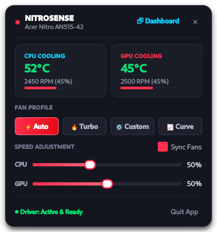
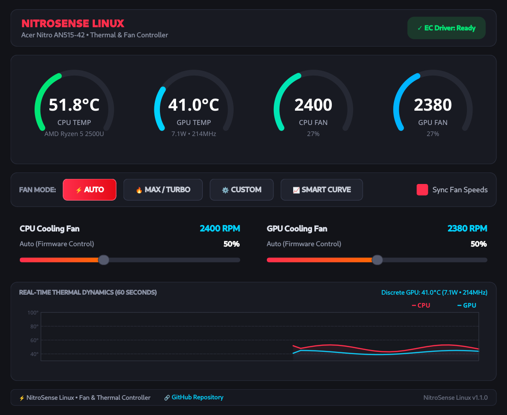

# NitroSense Linux

A dedicated, native Linux GUI and Embedded Controller (EC) fan driver for **Acer Nitro laptops**.


---

## Overview

On Acer Nitro laptops, cooling fans are managed directly through the proprietary **ITE Embedded Controller (EC)** on the motherboard rather than standard CPU/GPU PWM headers.

NitroSense Linux bridges this gap by combining:
- A high-performance kernel module (`acer-nitro-ec`) exposing standard `/sys/class/hwmon/` sysfs control interfaces.
- A modern PyQt6 desktop dashboard with live dials, history charts, and profile switching.
- **Top Status Bar Mini Control Dropdown**: Instant 1-click access right from your top panel to monitor temperatures, fan speeds, and control fans without having to open the full dashboard.
- **Privacy-First & Zero Telemetry**: 100% offline operation. No IP, MAC address, hardware serial numbers, or personal data are ever read, stored, or transmitted.

---

## Previews

<div align="center">
  <h3>Top Status Bar Mini Control Dropdown</h3>
  <p><i>Instant 1-click monitoring and fan control right from your top panel</i></p>
  
</div>

<br/>

<div align="center">
  <h3>Full NitroSense Dashboard</h3>
  <p><i>Real-time circular dials, rolling thermal dynamic graph, and dual fan controls</i></p>
  
</div>

---

## Features

- **Top Status Bar Mini Control Dropdown**:
  - Click the status bar icon to toggle a sleek popover dropdown right below your top panel.
  - Live CPU & GPU temperature badges and dynamic color-coded alerts.
  - Real-time fan RPM readings and percentage meters.
  - 1-click fan profile switches: **Auto**, **Turbo**, **Custom**, and **Smart Curve**.
  - Interactive fan speed sliders with synchronized control and manual override.
  - Quick action to expand into the full dashboard or quit.
- **Full NitroSense Dashboard**:
  - High-precision circular gauges for CPU/GPU temperatures and RPMs.
  - Dynamic 60-second rolling thermal dynamics graph.
  - Dual independent or synchronized fan speed sliders.
- **Fan Control Profiles**:
  - ⚡ **Auto**: Default firmware EC thermal curve.
  - 🔥 **Max / Turbo**: Forced 100% boost for gaming, heavy compiling, or rendering.
  - ⚙️ **Custom**: Precision duty cycle sliders (20%–100% CPU, 0%–100% GPU).
  - 📈 **Smart Dynamic Curve**: Intelligent software-managed thermal curve reacting dynamically to peak temperatures.
- **Built-in Safety Protections**:
  - **Thermal Safety Floor**: Automatically escalates fan speed if temperatures exceed 82°C.
  - **Auto-Recovery on Shutdown**: Restores fans to safe firmware Auto mode on exit.
- **Dynamic Hardware Discovery**:
  - Automatically identifies system model, CPU, discrete GPU, and integrated GPU.
  - No hardcoded PCI bus IDs or hardware models.

---

## Installation & Setup

### Prerequisites

Ensure Python 3, PyQt6, and kernel build headers are installed:

```bash
# Debian / Ubuntu / Kali
sudo apt update
sudo apt install python3 python3-pyqt6 build-essential dkms linux-headers-$(uname -r)

# Arch Linux / Manjaro
sudo pacman -S python python-pyqt6 base-devel dkms linux-headers
```

### 1. Clone the Repository

```bash
git clone https://github.com/killindodo/nitrosense-linux.git
cd nitrosense-linux
```

### 2. Activate the Kernel Driver (One-Time)

Run the automated installer script:

```bash
sudo ./scripts/install_driver.sh
```

This script:
1. Compiles the `acer-nitro-ec` kernel module.
2. Installs it into `/lib/modules/$(uname -r)/updates/`.
3. Registers it with **DKMS** for automatic rebuilds across kernel updates.
4. Configures `/etc/modules-load.d/acer-nitro-ec.conf` to load automatically on boot.
5. Installs `/etc/udev/rules.d/99-acer-nitro-ec.rules` so unprivileged users can adjust fan speeds without entering `sudo`.

### 3. Desktop Integration (Optional)

To add NitroSense to your application launcher, desktop, and system PATH:

```bash
./install_desktop.sh
```

---

## Usage

Launch NitroSense from your application menu or terminal:

```bash
nitrosense
```

To start minimized directly to the top status bar / system tray:

```bash
nitrosense --tray
```

- **Click the top status bar widget** to open the **Mini Control Dropdown**.
- **Double-click** or click **Dashboard** in the dropdown to expand the full dashboard.
- **Right-click** for quick context menu presets.

---

## License

GPL-2.0 / MIT
